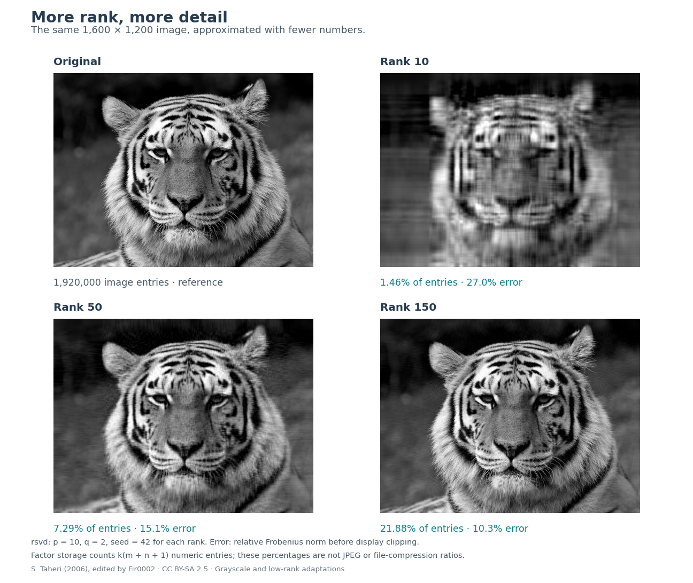
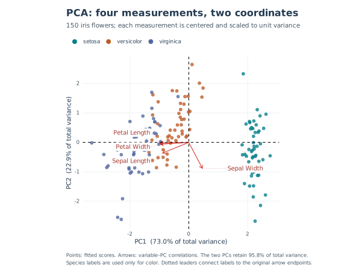

[](https://github.com/erichson/rSVD/actions/workflows/R-CMD-check.yaml)
[](https://CRAN.R-project.org/package=rsvd)

# Randomized matrix decompositions in R

A matrix may have thousands of columns while much of its variation follows
only a few patterns. Photographs contain repeated shapes, and measured
variables often change together. A low-rank approximation represents this
shared structure through a small set of directions and the weights needed
to combine them.

**rsvd** computes these approximations for dimension reduction, compression,
and data analysis. It uses random combinations of the input to find a small
subspace, then performs the main factorization within that subspace. This
can reduce the work when the requested rank is small relative to the matrix
dimensions and the singular values decay.

The package provides several matrix decompositions, principal component
analysis, and robust principal component analysis, together with plotting
functions. It accepts ordinary R matrices and supports sparse matrices from
**Matrix**. Randomized principal component analysis can center and scale
sparse input implicitly, avoiding a dense copy of the processed data. The
[package paper](https://www.jstatsoft.org/article/view/v089i11) describes the
algorithms and their applications.

## Installation

```r
install.packages("rsvd")

# Development version:
# install.packages("remotes")
# remotes::install_github("erichson/rSVD")
```

The development version is **2.0.0**; the CRAN badge shows the published version.
rsvd requires **R 4.4 or later and Matrix 1.7-0 or later**. The minimum R
version follows the Matrix dependency. CI also tests newer R releases
alongside the R 4.4 series. Sparse dispatch works without attaching Matrix
with `library(Matrix)`.

## What a low-rank factorization represents

Consider a matrix whose columns are measurements, images, or time series.
Its **rank** is the number of independent directions spanned by those
columns. If every column can be assembled from ten underlying patterns,
the matrix has rank at most ten, regardless of how many columns it contains.
A factorization stores the patterns and the coefficients that reconstruct
each column from them.

Measured data rarely have exactly low rank. Noise may make a matrix
full rank even when most of its variation follows a few
patterns. A **low-rank approximation** retains those patterns and leaves a
residual, the difference between the data and their reconstruction. Working
with the approximation can reduce storage and simplify later calculations
or visualization. The application determines which residual is acceptable;
rank alone cannot distinguish noise from a weak but useful signal.

The **singular value decomposition (SVD)** gives orthogonal directions for
representing this variation. Keeping the leading `k` terms gives

```math
A \approx U_k D_k V_k^{T}.
```

The columns of **U** and **V** are orthonormal left and right directions,
respectively, and **D** is diagonal. Its nonnegative entries are the singular
values,
ordered from largest to smallest. Each left direction, right direction,
and singular value defines one rank-one pattern. The squared singular
value measures that pattern's contribution to the squared Frobenius norm,
so the leading terms retain the strongest variation first. The exact
truncated SVD minimizes the Frobenius error among rank-`k` approximations.
Randomized SVD aims to approach this accuracy while reducing the cost of
finding the directions.

The equations here use real matrices, for which superscript **T** denotes
transpose. With complex input, reconstruction uses **H**, the conjugate
transpose, which also conjugates the matrix entries. rsvd supports complex
matrices; the reconstruction code must use the corresponding transpose.

## Reconstructing a tiger image

An image makes the role of these patterns visible. A grayscale image is a
matrix of pixel intensities. Its leading SVD terms capture broad shapes
and repeated features, while additional terms recover finer detail. The
bundled tiger image lets us compare the original pixels with reconstructions
at different ranks.

```r
library(rsvd)
data(tiger)

set.seed(42)
fit <- rsvd(tiger, k = 150)

# Keep fit$u, fit$d, and fit$v for a compact representation.
# Reconstruct only when a dense image is needed; avoid an explicit diag(fit$d).
tiger_approx <- tcrossprod(sweep(fit$u, 2, fit$d, "*"), fit$v)
norm(tiger - tiger_approx, "F") / norm(tiger, "F")
```

For complex data, reconstruct with
`sweep(fit$u, 2, fit$d, "*") %*% Conj(t(fit$v))`.



*Increasing the rank improves the tiger reconstruction at the cost of larger
factors. For this 1,600-by-1,200 image, rank 50 stores 7.3% of the original
number of numeric entries and has 15.1% relative Frobenius error. Rank 150
stores 21.9% of the entries and reduces the error to 10.3%. The panels show
the original image and reconstructions at ranks 10, 50, and 150.*

An `m`-by-`n` matrix contains `m * n` numbers. Its rank-`k` SVD factors contain
`k * (m + n + 1)`, accounting for both sets of directions and the singular
values. These counts describe numeric storage in matrices and factors;
JPEG and PNG compression use different representations. Reconstructing
the image allocates the full dense matrix again, so storing the factors
preserves the compact representation.

Many calculations can use the factors directly. To multiply the
approximation by a vector, project the vector onto V, multiply the resulting
`k` coefficients by the singular values, and combine the columns of U with
those weights. The work grows with `k * (m + n)` rather than `m * n`.
This saving applies to subsequent products as well as any saving obtained
when computing the factorization.

Image: S. Taheri (2006), edited by Fir0002,
[CC BY-SA 2.5](https://creativecommons.org/licenses/by-sa/2.5/),
via [Wikimedia Commons](https://commons.wikimedia.org/wiki/File:Sibirischer_tiger_de_edit02.jpg).
The package supplies a grayscale version, and the panels add low-rank
reconstructions. [Reproduce this figure](tools/benchmarks/tiger-results/README.md).

## Finding the dominant directions with random sampling

The tiger example shows how to use the factors. Computing them efficiently
starts with finding a subspace that captures most of the
input's variation. Suppose A is a tall matrix with `m` rows and `n` columns,
and we want `k` dominant directions. A random weighted combination of its
columns contains contributions from many directions at once. Directions
with larger singular values contribute more strongly, allowing a small
collection of these combinations to capture the dominant subspace.

The algorithm draws a random matrix called omega with `n` rows and
`ell = min(k + p, m, n)` columns. Its entries are Gaussian by default. Up to
`p` extra columns provide oversampling, which helps capture directions near
the truncation boundary. Multiplying A by this random matrix forms a
**sketch**, and a thin QR factorization gives an orthonormal basis Q for
the sketch. The original data are then projected onto that basis. The
two matrix products are

```math
Y = A\Omega, \qquad B = Q^{T}A.
```

Y contains the random combinations, while B expresses the original columns
in the coordinates of Q. The product QB approximates A. Because B has only
`ell` rows, its SVD is much smaller than the original problem. For a
**20,000 × 6,000** input with `k = 40` and `p = 10`, B has size
**50 × 6,000**, or 300,000 entries compared with 120 million in A.
Q has 20,000 × 50 entries. Products with the input and the factorization
routines require additional workspace beyond these compressed arrays.

The algorithm computes an ordinary SVD of B and retains its leading `k`
terms. Multiplying its left singular vectors by Q maps them back to the
original coordinates. Its right singular vectors can be used directly,
and its singular values approximate those of A. The returned `fit$d`
stores these values as a vector. Random sampling therefore determines the
subspace in which conventional numerical linear algebra completes the
factorization. Wide inputs are handled through the conjugate-transposed
problem.

### Refining the subspace

When singular values decay slowly, a small initial sketch may miss some
directions near the chosen rank. Power iterations strengthen the separation
between dominant and trailing directions before the final projection.
With `q` iterations, the idealized sketch is

```math
Y = (AA^{T})^q A\Omega.
```

This operation raises each singular value to the power `2 * q + 1`, giving
larger values greater weight. The implementation obtains this effect through
successive products with A and its transpose, with orthonormalization after
each product. It avoids forming either the matrix of cross-products or its
power. Each added iteration requires further passes over the input.
The [package paper](https://www.jstatsoft.org/article/view/v089i11) develops
the method through worked examples, and the
[Halko–Martinsson–Tropp survey](https://arxiv.org/abs/0909.4061) gives its
error analysis.

### How the smaller problem reduces computation and storage

For a dense tall matrix, a full SVD requires work on the scale of `m * n^2`.
With a fixed number of power iterations, the main randomized products cost
on the scale of `m * n * ell`. Thin QR and SVD calculations add work on
the scale of `(m + n) * ell^2`. A sketch much narrower than the input can
therefore reduce the total work substantially. The products also use
optimized BLAS routines. Small inputs and ranks near the full dimension
leave less room to recover the overhead of forming the sketch.

The algorithm still reads the input repeatedly. The default `q = 2`
requires six products with A or its transpose, including the final
projection. Each product applies the matrix to a small collection of
vectors, and the subsequent factorization uses the compressed result.
Increasing `q` can improve the approximation to the dominant subspace,
at the cost of additional products.

The main thin arrays grow with `(m + n) * ell`, while a dense input occupies
`m * n` entries. Sparse products can use the stored entries of A, although
the sketches and factors are generally dense. Sparsity alone says little
about approximation quality; a matrix with many zeros may still require
many directions. The sparse examples below combine structure that admits
a low-rank approximation with computation that preserves sparse input.
Their cumulative R allocation measurements also include temporary objects,
so they exceed the storage needed for the final factors.

## Using the factorization for PCA

The same low-rank representation provides the main computation for
**principal component analysis (PCA)**. After centering the observations
and optionally scaling the variables, the right singular vectors give
the principal loadings. The left singular vectors, weighted by their
singular values, give the fitted scores. Keeping a few score columns
places each observation in a small set of coordinates that describes
the dominant variation in the processed data.

The iris data provide a small example whose coordinates are easy to
interpret. The larger examples below measure computational performance.
Install `ggplot2` to use the plotting helpers.

```r
library(rsvd)
data(iris)
set.seed(42)
pca <- rpca(as.matrix(iris[, 1:4]), k = 2, center = TRUE, scale = TRUE)
ggbiplot(pca, groups = iris$Species, ellipse = FALSE,
         ind_labels = FALSE)
```



*The first two components retain 95.8% of total variance in the centered,
standardized iris measurements. Points are fitted flower scores, and arrows
show variable–component correlations. The nearly parallel petal arrows
indicate similar directions of variation. Species labels determine color
and are excluded from fitting.*

The figure adds a legend and separates variable labels for readability.
[Reproduce the styled figure and its numerical checks](tools/benchmarks/example-results/README.md).

## Selecting columns and rows with ID and CUR

An SVD direction may combine every variable. When the original variables
or observations have a useful interpretation, it can be preferable to
express an approximation through actual columns or rows. An
**interpolative decomposition (ID)** selects a subset of columns and uses
them to reconstruct the others. For example, when columns are sensor
measurements, their indices identify the sensors retained in the
approximation. A column ID has the form

```math
A \approx CZ.
```

C contains `k` selected columns of A, and Z gives the coefficients used
to reconstruct every column from that subset. At the selected indices,
Z contains an identity matrix, so those columns reproduce themselves.
`rid()` returns `C`, `Z`, and the column indices in `idx`. With
`mode = "row"`, it selects rows in `R` and reconstructs as `Z %*% R`.

**CUR** extends this idea by retaining both columns and rows. A small
connector matrix U combines the columns in C with the rows in R,

```math
A \approx CUR.
```

For an observations-by-variables matrix, C contains actual variables
and R contains actual observations. Here U is a `k`-by-`k` connector;
the use of the letter U is separate from its role as the left factor
in an SVD. `rcur()` returns `C.idx` and `R.idx` alongside the factors,
allowing the selections to be traced back to the data. Both ID and CUR
omit rows containing missing values with a warning. Returned row indices
then refer to the remaining complete observations.

In the tiger image, the selected columns and rows are strips of pixels.
Their interpolation and connector factors reconstruct the full image
from those strips.

```r
set.seed(42)
id <- rid(tiger, k = 50)
id$idx[1:6]                     # Original column positions
tiger_id <- id$C %*% id$Z

set.seed(42)
cur <- rcur(tiger, k = 50)
tiger_cur <- cur$C %*% cur$U %*% cur$R

c(ID = norm(tiger - tiger_id, "F") / norm(tiger, "F"),
  CUR = norm(tiger - tiger_cur, "F") / norm(tiger, "F"))
```

Requiring factors to contain observed columns and rows restricts the
possible approximations and usually sacrifices some accuracy relative
to SVD. The selected columns need not be orthogonal, and different
valid subsets can have different residuals. Selection also depends on
the input's units and scaling, since ID and CUR do not standardize
variables automatically. The residual measures how well a subset
reconstructs the data; the indices alone do not establish causal
importance. The [package paper](https://www.jstatsoft.org/article/view/v089i11)
describes the pivoted-QR constructions used by these routines.

## Available decompositions

The functions below expose these representations directly. `rqb()`
returns the basis and projected matrix used in the randomized
factorization, while `rrpca()` separates low-rank structure from
entrywise sparse corruption.

| Function | Result and typical use |
| --- | --- |
| `rsvd(A, k)` | Leading singular vectors and values for low-rank compression. |
| `rpca(A, k)` | Principal loadings, component variances, and optional scores. |
| `rqb(A, k)` | An orthonormal basis Q and a compressed matrix B. The randomized basis includes oversampling. |
| `rid(A, k)` | Selected columns and interpolation coefficients; row ID is also available. |
| `rcur(A, k)` | Selected columns, selected rows, and their connector matrix. |
| `rrpca(A)` | A low-rank component and an entrywise sparse corruption component. |

## Choosing rank and assessing accuracy

The requested rank determines how much variation the approximation can
retain. A small `k` gives the largest computational saving, but its
adequacy depends on the application and the spectrum of the input.
For `rsvd(A, k, p = 10, q = 2)`, the parameters `p` and `q` control how
accurately the algorithm finds a subspace of that rank.

The nonnegative integer `p` adds sketch columns, up to the matrix
dimensions, to help capture the target subspace. The nonnegative integer
`q` adds power iterations. Increasing it can improve accuracy for slowly
decaying spectra, while requiring more passes over the data. ID and CUR
use `q = 0` by default.

A useful reference for accuracy is the energy left outside the leading
directions. Write A<sub>k</sub> for the exact truncated SVD, and order the
singular values of A from largest to smallest. Its squared Frobenius
residual is

```math
\|A-A_k\|_F^2 = \sum_{j>k}\sigma_j^2.
```

The Frobenius norm is the square root of the sum of squared magnitudes
of the matrix entries. The equation says that the smallest possible
squared reconstruction error equals the sum of the squared singular values
discarded after the first `k` terms. A full-rank matrix can therefore
have a good low-rank approximation if those trailing values are small.
For a flat spectrum and a rank much smaller than the dimensions, even
the optimal approximation leaves a large relative residual.

Tests and benchmarks compare reconstruction errors with this truncation
error and check orthogonality and subspaces. Exact recovery is an
appropriate expectation for an exact low-rank test matrix. Individual
singular vectors can change sign or complex phase, and repeated
singular values allow rotations within a subspace. `set.seed()` controls
sampling in a fixed numerical environment; BLAS or package changes can
still produce different vectors.

Omitting `k` in `rsvd()` requests the full available rank. This remains
supported, including downstream uses such as Procrustes alignment,
but removes the computational advantage of a small target rank.
Base `svd()` is a natural reference for a full deterministic SVD.

## Measured performance

The benchmarks examine how these savings appear at larger matrix sizes,
while comparing the same requested rank and returned factors. The
synthetic inputs contain low-rank signal plus noise. Scaling cases run
from **10,000 × 3,000 to 20,000 × 6,000**, and dense PCA, ID, and CUR use
**15,000 × 4,500** inputs. Measurements were made on Linux x86_64 with
R 4.6.1, Matrix 1.7-6, and OpenBLAS 0.3.26 using four BLAS threads.
Reported times are medians of five calls after warmup, with method order
rotated between repetitions.

Tables pair **deterministic / randomized** measurements. **Speedup** is
the deterministic median divided by the randomized median, calculated
before rounding. A 10× speedup therefore means one tenth of the reference
runtime. The figures show absolute costs alongside ratios to make the
scale of each saving visible.

**R allocations** measure cumulative bytes allocated during a separate
profiled call, in GiB (`2^30` bytes). This quantity includes temporary R
objects but does not measure peak resident memory or live workspace, and
it does not capture every allocation inside native libraries. Input
generation, explicit garbage collection, and error calculations are
excluded. Preprocessing and any required sparse-to-dense conversion
are included.

Relative error divides the Frobenius reconstruction residual by the
Frobenius norm of the input, using the centered and scaled observations
for PCA. The percentages report reconstruction error; explained
variance uses a different quantity. The [benchmark guide](tools/benchmarks/README.md)
provides the fixtures, baseline calls, raw observations, environment,
and commands needed to reproduce these results.

### SVD as matrix dimensions grow

At rank 40, the measured SVD speedup increases from 24.2× to 45.3×
across the sizes in the table, with relative reconstruction errors
close to those of the deterministic reference. The comparison uses
`base::svd(A, nu = k, nv = k)` and `rsvd()` with `p = 10, q = 2`.
Base SVD computes the full singular spectrum even when only `k`
vectors are requested. This baseline therefore measures the saving
relative to a full SVD calculation; it does not characterize every
specialized truncated-SVD solver.

<!-- BEGIN BENCHMARK SVD -->

| Input | k | Time (s) | Speedup | R allocations (GiB) | Relative error |
| --- | ---: | ---: | ---: | ---: | ---: |
| Dense, 10,000 × 3,000 | 40 | 16.858 / 0.697 | **24.2×** | 1.234 / 0.133 | 9.67% / 9.68% |
| Dense, 20,000 × 6,000 | 40 | 97.157 / 2.144 | **45.3×** | 4.928 / 0.267 | 9.67% / 9.68% |

<!-- END BENCHMARK SVD -->


*At 20,000 × 6,000, randomized SVD is 45.3× faster and reduces cumulative
R allocations by a factor of 18.5 relative to base SVD. The relative errors
are 9.68% and 9.67%, respectively, so most of the residual comes from rank-40
truncation. The plot holds `k = 40` while input size grows from 30 million
to 120 million entries. Shading gives the interquartile range of timings,
and whiskers show their minimum and maximum. Ratio panels use a 1×
reference line.*

The largest dense input alone occupies about 0.89 GiB in double precision,
before factorization workspace. Input size and the ratio of sketch width
to input width affect the measured advantage. These results describe
the stated inputs and numerical environment; speedup will vary with
the matrix and the computation requested.

### PCA on dense and sparse input

PCA adds preprocessing to the factorization. Both methods here center
and scale columns and return `k = 40` loadings and score columns. The
reference is `prcomp(as.matrix(A), rank. = k, center = TRUE, scale. = TRUE)`.
Randomized PCA uses `p = 10, q = 2`. The sparse fixtures have 5% nonzero
entries in twenty noisy blocks, and `rpca()` applies their centering
and scaling through sparse products.

The dense case gives a 10.3× speedup with both reconstruction errors
rounding to 10.3%. For the largest sparse case, the speedup is 56.0×,
with both errors rounding to 0.548%. The sparse comparison includes
the cost of dense preprocessing in the reference.

<!-- BEGIN BENCHMARK PCA -->

| Input | k | Time (s) | Speedup | R allocations (GiB) | Relative error |
| --- | ---: | ---: | ---: | ---: | ---: |
| Dense PCA, 15,000 × 4,500 | 40 | 54.085 / 5.256 | **10.3×** | 8.056 / 2.981 | 10.3% / 10.3% |
| Sparse-input PCA, 10,000 × 3,000 | 40 | 18.336 / 0.463 | **39.6×** | 3.806 / 0.213 | 0.516% / 0.516% |
| Sparse-input PCA, 20,000 × 6,000 | 40 | 110.634 / 1.976 | **56.0×** | 15.212 / 0.482 | 0.548% / 0.548% |

<!-- END BENCHMARK PCA -->


*At the largest size, PCA with implicit sparse preprocessing is 56.0×
faster and reduces cumulative R allocations by a factor of 31.5 relative
to `prcomp()`.
It is also 5.1× faster than `rpca(as.matrix(A), ...)` on the same input.
All three curves use the same observations, preprocessing choices,
and requested output. The figure reports the maximum observed error
relative to the optimal rank-40 error.*

The third curve keeps the randomized solver while changing whether
the input is densified. This comparison separates the benefit of
preserving sparse storage from the benefit of randomized factorization.
The speedup over `prcomp()` peaks at the middle size; runtime variation
and machine behavior mean it need not increase monotonically with
matrix dimensions.

Here PCA on sparse input produces ordinary principal components.
The loadings are generally dense, since `rpca()` does not impose
sparsity on them.

### ID and CUR

For ID and CUR, the deterministic references are `rid(rand = FALSE)`
and `rcur(rand = FALSE)`, which use LAPACK column-pivoted QR. Base R
has no corresponding functions. Both paths return the selected
data subsets together with their interpolation or connector factors.
Randomized calls use `k = 40, p = 10, q = 0`.

These subset approximations reduce computation while allowing their
residuals to differ from the deterministic selections. For example,
the dense column ID gives a 63.9× speedup, with relative error increasing
from 14.3% to 15.8%. The sparse column ID gives a 163.5× speedup, and
both errors round to 0.153%.

<!-- BEGIN BENCHMARK ID_CUR -->

| Input | k | Time (s) | Speedup | R allocations (GiB) | Relative error |
| --- | ---: | ---: | ---: | ---: | ---: |
| Column ID, dense, 15,000 × 4,500 | 40 | 43.727 / 0.684 | **63.9×** | 1.257 / 0.326 | 14.3% / 15.8% |
| CUR, dense, 15,000 × 4,500 | 40 | 42.141 / 1.076 | **39.2×** | 1.546 / 0.615 | 18.1% / 19.2% |
| Column ID, sparse, 15,000 × 4,500 | 40 | 46.938 / 0.287 | **163.5×** | 1.522 / 0.095 | 0.153% / 0.153% |
| CUR, sparse, 15,000 × 4,500 | 40 | 40.352 / 0.346 | **116.6×** | 1.572 / 0.145 | 0.189% / 0.189% |

<!-- END BENCHMARK ID_CUR -->

Column-pivoted QR does not guarantee the optimal rank-`k` approximation
for every input. Reporting the residual beside time and allocations
shows the accuracy attained by each selection, including the cases
where the randomized result has a larger error.

## PCA preprocessing and sparse storage

The sparse PCA measurements depend on how preprocessing is carried
out. Subtracting a nonzero mean from a sparse column turns its structural
zeros into nonzero values. Storing the centered matrix explicitly
would therefore usually require dense storage. Products with that
matrix can instead be computed from the sparse input and a correction.
For a vector of column means mu and a sketch matrix W,

```math
(A-\mathbf{1}\mu^{T})W = AW-\mathbf{1}(\mu^{T}W).
```

The vector **1** has an entry equal to one for each row of A. The first term on
the right uses a sparse product. The second repeats the weighted
column means across rows, giving the rank-one centering correction.
`rpca()` combines this identity with implicit scaling to work with
the processed observations. The sketches and loadings are dense,
but the full centered input need not be stored.

```r
set.seed(42)
# A 10,000 by 3,000 sparse matrix: 20 signal-plus-noise blocks, 5% density.
A <- Matrix::bdiag(replicate(20, {
  signal <- outer(seq_len(500) / 500, seq_len(150) / 150)
  signal + matrix(rnorm(500 * 150, sd = 0.001), 500, 150)
}, simplify = FALSE))
fit <- rpca(A, k = 20, center = TRUE, scale = TRUE, retx = FALSE)
scores <- predict(fit, A[1:5, , drop = FALSE])
```

An explicit `k` and `rand = TRUE` enable this preprocessing for real
sparse Matrix inputs. `retx = FALSE` omits training scores and avoids
computing unused left singular vectors. Prediction applies the fitted
transformation to new observations. Supply their columns in the
**training order**, since names are not used to reorder them.

As in `prcomp()`, `center = FALSE` skips centering. It can be used
with data already centered by the caller or to request an uncentered
SVD. When centering is off, `scale = TRUE` divides a real column by
`sqrt(sum(x^2) / (nrow(A) - 1))`, which generally differs from its
centered standard deviation. `rpca()` enables scaling by default,
whereas `prcomp()` leaves it off. The existing rsvd convention replaces
scales below `1e-8` with 1.

The returned `fit$var` accounts for all processed observations, including
variation outside the retained components. It is their squared
Frobenius norm divided by `m - 1`, where `m` is the number of complete
observations. With centering, this equals the sum of all component
variances, so explained proportions use the same denominator for
every `k`. Without centering, it measures total squared energy with
the same normalization. Sample variances require at least two complete
observations, and explained proportions are undefined when the
processed input has zero energy.

Fitted scores use the `U D` convention. `predict()` instead projects
observations onto the fitted loadings, so prediction on the training
data can differ from the stored scores by the randomized approximation
residual. This distinction matters when comparing fitted coordinates
with projections of new observations.

### Storage used by each routine

The preprocessing choice is one part of the memory cost. The table
summarizes where the algorithms preserve sparse input and where
dense arrays are required.

| Routine | Sparse input and dense workspace |
| --- | --- |
| `rsvd()`, randomized `rqb()` | Keep sparse input for products; sketches, bases, and projected factors are generally dense. |
| Randomized `rid()`, `rcur()` | Use sparse sketch products and dense projected or selected factors. |
| `rpca(rand = TRUE, k = ...)` | Centers/scales real sparse input implicitly; loadings, sketches, and optional scores are dense. |
| `rpca(rand = FALSE)` or `rpca(k = NULL)` | Uses dense preprocessing and deterministic SVD. |
| Deterministic `rid()`, `rcur()` | Use dense pivoted QR, which can require a full dense copy. |
| Deterministic `rqb()` | Factors an independent real leading block when it reproduces the base-QR basis; otherwise falls back to full dense QR. |
| `rrpca()` | Uses dense input and dense working arrays. |

For `ell = min(k + p, min(dim(A)))`, thin randomized workspace scales
with `(nrow(A) + ncol(A)) * ell`, in addition to input storage and
factorization workspace. Sparse preprocessing also uses storage
proportional to the stored entries. A full reconstruction or residual
matrix is dense even for sparse input, so retaining factors can avoid
that allocation.

`rid(idx_only = TRUE)` and `rcur(idx_only = TRUE)` omit the selected
data subsets from the return value. They still compute the interpolation
or connector factors, which remain part of the calculation's cost.

## Separating low-rank structure from sparse corruption

The preceding decompositions approximate the observed matrix directly.
Robust PCA instead models it as a low-rank component plus an entrywise
sparse corruption component. `rrpca()` seeks this separation by minimizing
a nuclear norm plus `lambda` times an entrywise absolute sum. The nuclear
norm is the sum of singular values and encourages a low-rank component;
the absolute-sum penalty encourages sparsity in the corruption component.

Many candidate splits can reconstruct the same input closely, so a small
reconstruction residual alone cannot establish that the objective has
been minimized. The solver checks both reconstruction feasibility and
stationarity. It expands saturated singular-value thresholding steps
and refines stalled randomized updates, using an exact-SVD fallback
when necessary.

`maxiter` limits the work and can stop the solver before convergence.
The returned `err` records reconstruction errors; `trace = TRUE` also
reports the stationarity diagnostic. Stronger convergence checks can
require more computation, and the method retains dense working arrays.
The [release review](tools/validation/release-review.md) describes the
optimality checks used in validation and what they establish.

## Tests, release notes, and reproducibility

```sh
R CMD build .
R CMD check rsvd_2.0.0.tar.gz
```

With development dependencies installed, `testthat::test_local()` runs
the suite interactively. The tests assess approximation against prescribed
spectra, invariant subspaces, complex arithmetic, and public result shapes.
They also cover sparse representations and implicit PCA products,
rank-deficient ID and CUR, and rank selection and convergence in robust
PCA. CI verifies the Matrix version before testing on Linux, Windows,
and macOS, including R 4.4 with Matrix 1.7-0 at the supported minimum.

[NEWS.md](NEWS.md) records the changes in 2.0.0, including compatibility
and memory behavior. The [release review](tools/validation/release-review.md)
documents the numerical audit, downstream checks, supported environments,
and remaining limitations. The [benchmark guide and measurements](tools/benchmarks/README.md)
provide the scripts and data for reproducing the tables and figures
or evaluating matrices representative of another workload.

## References and citation

- Erichson, N. B., Voronin, S., Brunton, S. L., and Kutz, J. N. (2019).
  [Randomized Matrix Decompositions Using R](https://www.jstatsoft.org/article/view/v089i11).
  *Journal of Statistical Software*, 89(11), 1–48.
- Halko, N., Martinsson, P.-G., and Tropp, J. A. (2011).
  [Finding Structure with Randomness: Probabilistic Algorithms for Constructing Approximate Matrix Decompositions](https://arxiv.org/abs/0909.4061).
- Voronin, S. and Martinsson, P.-G. (2015).
  [RSVDPACK: Subroutines for Computing Partial Singular Value Decompositions via Randomized Sampling](https://arxiv.org/abs/1502.05366).

```bibtex
@Article{,
  title = {Randomized Matrix Decompositions Using {R}},
  author = {N. Benjamin Erichson and Sergey Voronin and Steven L.
    Brunton and J. Nathan Kutz},
  journal = {Journal of Statistical Software},
  year = {2019},
  volume = {89},
  number = {11},
  pages = {1--48},
  doi = {10.18637/jss.v089.i11},
}
```
