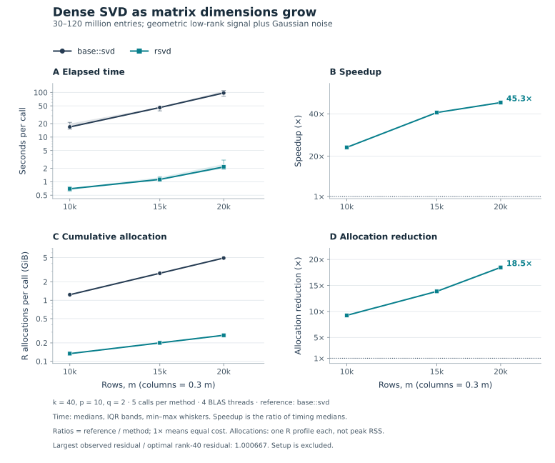
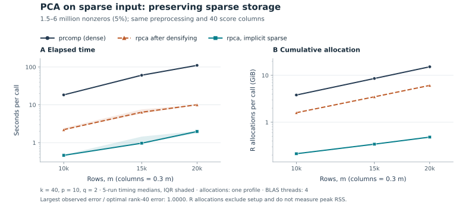

[](https://github.com/erichson/rSVD/actions/workflows/R-CMD-check.yaml)
[](https://CRAN.R-project.org/package=rsvd)

# Randomized matrix decompositions in R

**rsvd** computes low-rank matrix approximations for dimension reduction,
compression, and data analysis. A randomized range finder captures the dominant
directions of a matrix in a small subspace; a conventional factorization then
solves the smaller problem. This is especially useful when the requested rank
is much smaller than both matrix dimensions and the singular values decay.

The package provides SVD, PCA, QB, interpolative (ID), CUR, and robust-PCA
decompositions. It accepts ordinary R matrices and supports sparse matrices
from **Matrix**, with implicit centering and scaling for randomized PCA.
The [package paper](https://www.jstatsoft.org/article/view/v089i11) explains
the algorithms and their applications.

## Installation

```r
install.packages("rsvd")

# Development version:
# install.packages("remotes")
# remotes::install_github("erichson/rSVD")
```

The development version is **1.0.7**; the CRAN badge shows the published version.
rsvd requires **R 4.4 or later and Matrix 1.7-0 or later**. Matrix need not be
attached with `library(Matrix)` for sparse dispatch to work.

## A first example

```r
library(rsvd)
data(tiger)

set.seed(42)
fit <- rsvd(tiger, k = 150)

# Keep fit$u, fit$d, and fit$v for a compact representation.
# Reconstruct only when a dense image is needed; avoid an explicit diag(fit$d).
tiger_approx <- tcrossprod(sweep(fit$u, 2, fit$d, "*"), fit$v)
norm(tiger - tiger_approx, "F") / norm(tiger, "F")
```

For complex data, reconstruct with
`sweep(fit$u, 2, fit$d, "*") %*% Conj(t(fit$v))`.

| Function | Result and typical use |
| --- | --- |
| `rsvd(A, k)` | Singular vectors and values for `A ≈ U D V*`; low-rank compression. |
| `rpca(A, k)` | Principal loadings, component variances, and optional scores. |
| `rqb(A, k)` | `A ≈ Q B`, with an orthonormal basis for a compressed problem. The randomized basis includes oversampling. |
| `rid(A, k)` | A column ID, `A ≈ C Z`, using actual columns of `A`; row ID is also available. |
| `rcur(A, k)` | `A ≈ C U R`, using actual columns and rows of `A`. |
| `rrpca(A)` | A low-rank plus entrywise sparse decomposition, `A ≈ L + S`. |

Here `V*` denotes the conjugate transpose. ID and CUR retain interpretable
subsets of the data; their residuals need not match a truncated SVD.

## Choosing rank and assessing accuracy

`rsvd(A, k, p = 10, q = 2)` has three main accuracy/cost controls:

- **`k`** is the requested rank. A small rank gives the largest computational
  advantage. Choose it according to the information the application needs.
- **`p`** is a nonnegative integer oversampling parameter. Extra sketch columns
  help capture the target subspace; the sketch is bounded by the matrix dimensions.
- **`q`** is a nonnegative integer number of power iterations. Increasing it
  can improve accuracy for a slowly decaying spectrum, at the cost of more
  passes over the input. The ID and CUR defaults use `q = 0`.

A full-rank matrix can still have a useful low-rank approximation. What matters
is the energy left outside the leading directions. If the exact singular
values are `d`, the best possible rank-`k` Frobenius residual is
`sqrt(sum(d[-seq_len(k)]^2))` for `k < length(d)`. A flat spectrum leaves a large
residual even for the optimal rank-`k` approximation.

Tests and benchmarks therefore compare reconstruction error with the optimal
truncation error, and check orthogonality and subspaces. Exact recovery is a
suitable expectation for an exact low-rank fixture. Singular-vector entries
can change sign, complex phase, or rotate within a repeated singular subspace.
`set.seed()` controls sampling in a fixed numerical environment; it does not
guarantee identical vectors across BLAS or package versions.

Omitting `k` in `rsvd()` requests the full available rank. This remains supported,
including downstream uses such as Procrustes alignment, but offers no small-rank
advantage. Base `svd()` is a natural reference for a full deterministic SVD.

## Measured performance

The following results compare **the same requested rank and returned factors**
with deterministic references. They were measured on Linux x86_64 with R 4.6.1,
Matrix 1.7-6, and OpenBLAS 0.3.26 using one BLAS thread. Times are medians of
five calls after warmup, with method order rotated between repetitions.
The synthetic matrices contain a low-rank signal plus noise; they are not exact
low-rank inputs. The tiger image is the dataset shipped with the package.

**R allocations** are the cumulative bytes allocated during a separate profiled
call, expressed in MiB. They are not peak resident memory or live workspace, and
do not include every allocation made inside native libraries. Fixture creation,
explicit garbage collection, and error calculation are outside the measurement;
preprocessing and any required sparse-to-dense conversion are inside it.

Relative error means `||A - A_approx||F / ||A||F`, or the same quantity for the
centered/scaled input in PCA. Values below are percentages, not variance
explained. The [benchmark guide](tools/benchmarks/README.md) includes the exact
fixtures, baseline calls, raw measurements, environment, and rerun commands.

### SVD: shapes, an image, and growth with size

The reference is `base::svd(A, nu = k, nv = k)`. Base SVD computes the full
singular spectrum even when only `k` vectors are requested; it is not a
specialized truncated-SVD solver. rsvd uses `p = 10, q = 2` here.

<!-- BEGIN BENCHMARK SVD -->

| Input | k | Time (s), deterministic / randomized | R allocations (MiB), deterministic / randomized | Relative error, deterministic / randomized |
| --- | ---: | ---: | ---: | ---: |
| Dense, large, 8,000 × 2,000 | 40 | 7.924 / 0.364 | 644.75 / 105.28 | 9.67% / 9.67% |
| Dense, tall, 4,000 × 1,000 | 40 | 0.981 / 0.098 | 162.16 / 52.71 | 9.67% / 9.68% |
| Dense, wide, 1,000 × 4,000 | 40 | 1.129 / 0.111 | 163.08 / 83.23 | 9.67% / 9.68% |
| Dense, square, 2,000 × 2,000 | 40 | 3.123 / 0.094 | 246.17 / 41.65 | 9.67% / 9.68% |
| Tiger image, 1,600 × 1,200 | 150 | 0.755 / 0.186 | 107.24 / 95.18 | 10.2% / 10.3% |

<!-- END BENCHMARK SVD -->



The table emphasizes matrices with millions of entries. The plot holds
`k = 40` while both dimensions grow, showing where the benefit begins.
Shading shows the interquartile range of the recorded times. Matrix size and
the ratio of sketch width to input width matter; the measured advantage is
not a universal speedup guarantee.

### PCA on dense and sparse input

Both methods center and scale columns and return `k = 40` loadings and score
columns. The reference is
`prcomp(as.matrix(A), rank. = k, center = TRUE, scale. = TRUE)`. The sparse
fixtures have 5% nonzero entries in twenty noisy blocks. Randomized PCA uses
`p = 10, q = 2` and applies centering/scaling through sparse products.

<!-- BEGIN BENCHMARK PCA -->

| Input | k | Time (s), deterministic / randomized | R allocations (MiB), deterministic / randomized | Relative error, deterministic / randomized |
| --- | ---: | ---: | ---: | ---: |
| Dense PCA, 4,000 × 1,000 | 40 | 1.147 / 0.202 | 483.00 / 224.58 | 10.2% / 10.2% |
| Sparse PCA, large, 6,400 × 1,600 | 40 | 4.818 / 0.144 | 1,312.34 / 127.00 | 0.495% / 0.495% |
| Sparse PCA, tall, 4,000 × 2,000 | 40 | 5.765 / 0.115 | 1,102.10 / 94.31 | 0.487% / 0.487% |
| Sparse PCA, wide, 2,000 × 4,000 | 40 | 5.825 / 0.110 | 1,103.53 / 91.23 | 0.511% / 0.511% |

<!-- END BENCHMARK PCA -->



The third curve, `rpca(as.matrix(A), ...)`, isolates the effect of preserving
sparse storage from the effect of using a randomized SVD. All three curves
use the same observations, preprocessing, and requested output. The maximum
observed error relative to the optimal rank-40 error is printed on each figure.

Here “sparse PCA” means **ordinary PCA computed from sparse input**. The
principal loadings are generally dense; `rpca()` does not impose sparsity on
the loadings.

### Interpretable factors: ID and CUR

The deterministic references are `rid(rand = FALSE)` and `rcur(rand = FALSE)`,
which use LAPACK column-pivoted QR. Base R has no corresponding ID or CUR
function. Both paths return the selected data subsets and their interpolation
or connector factors; randomized calls use `k = 40, p = 10, q = 0`.

<!-- BEGIN BENCHMARK ID_CUR -->

| Input | k | Time (s), deterministic / randomized | R allocations (MiB), deterministic / randomized | Relative error, deterministic / randomized |
| --- | ---: | ---: | ---: | ---: |
| Column ID, dense, 4,000 × 1,000 | 40 | 0.502 / 0.040 | 73.82 / 34.89 | 14.9% / 16.4% |
| CUR, dense, 4,000 × 1,000 | 40 | 0.556 / 0.055 | 98.81 / 59.88 | 19.2% / 19.9% |
| Column ID, sparse, 4,000 × 2,000 | 40 | 2.663 / 0.033 | 227.95 / 28.01 | 0.152% / 0.152% |
| CUR, sparse, 4,000 × 2,000 | 40 | 2.739 / 0.042 | 241.71 / 41.77 | 0.189% / 0.189% |

<!-- END BENCHMARK ID_CUR -->

These methods select columns and rows, so different valid selections can have
different residuals. Column-pivoted QR is not a guarantee of optimal rank-`k`
approximation on every matrix. The table reports the measured errors alongside
cost, including cases where a randomized selection is less accurate.

## PCA behavior and sparse storage

```r
set.seed(42)
# An 8,000 by 2,000 sparse matrix: 20 signal-plus-noise blocks, 5% density.
A <- Matrix::bdiag(replicate(20, {
  signal <- outer(seq_len(400) / 400, seq_len(100) / 100)
  signal + matrix(rnorm(400 * 100, sd = 0.001), 400, 100)
}, simplify = FALSE))
fit <- rpca(A, k = 20, center = TRUE, scale = TRUE, retx = FALSE)
scores <- predict(fit, A[1:5, , drop = FALSE])
```

An explicit target rank and `rand = TRUE` enable implicit centering/scaling for
real sparse Matrix inputs. Prediction uses the fitted transformation; supply
new columns in their **training order**. Names are not used to reorder them.
`retx = FALSE` omits training scores and avoids unused left singular vectors.

As with `prcomp()`, `center = FALSE` skips centering: this is appropriate for
already-centered data and also permits an uncentered SVD. With centering off,
`scale = TRUE` uses `sqrt(sum(x^2) / (nrow(A) - 1))`, generally not the centered
standard deviation. Unlike `prcomp()`'s default, `rpca()` defaults to scaling.
The existing rsvd convention replaces scales below `1e-8` with 1.

`fit$var` measures total processed energy across all directions, so explained
proportions use the same denominator regardless of `k`. Without centering it
is a total second moment. Fitted scores retain the `U D` convention, while
`predict()` projects observations onto the fitted loadings; these can differ
by the randomized approximation residual. Sample variances need at least two
complete observations, and explained proportions are undefined for zero energy.

| Routine | Sparse input and dense workspace |
| --- | --- |
| `rsvd()`, randomized `rqb()` | Keep sparse input for products; sketches, bases, and projected factors are generally dense. |
| Randomized `rid()`, `rcur()` | Use sparse sketch products and dense projected or selected factors. |
| `rpca(rand = TRUE, k = ...)` | Centers/scales real sparse input implicitly; loadings, sketches, and optional scores are dense. |
| `rpca(rand = FALSE)` or `rpca(k = NULL)` | Uses dense preprocessing and deterministic SVD. |
| Deterministic `rid()`, `rcur()` | Use dense pivoted QR, which can require a full dense copy. |
| Deterministic `rqb()` | Factors an independent real leading block when it reproduces the base-QR basis; otherwise falls back to full dense QR. |
| `rrpca()` | Uses dense input and dense working arrays. |

For sketch width `ell = min(k + p, min(dim(A)))`, thin randomized workspace
scales with `(nrow(A) + ncol(A)) * ell`, in addition to input storage and
factorization workspace. Sparse preprocessing also needs storage proportional
to the stored entries. A full reconstruction or residual matrix is dense even
when the original input is sparse. Keep factors when possible.

`rid(idx_only = TRUE)` and `rcur(idx_only = TRUE)` omit the selected data
subsets from the result, but still compute the interpolation or connector
factors. They are not index-selection-only algorithms.

## Robust PCA

`rrpca()` minimizes a nuclear norm plus `lambda` times an entrywise absolute
sum to separate a low-rank component from sparse corruption. A small
reconstruction residual alone does not establish that the split is optimal.
The solver checks reconstruction feasibility and stationarity, expands
saturated singular-value thresholding steps, and refines stalled randomized
updates before using an exact-SVD fallback when necessary.

`maxiter` remains a work limit and can stop before convergence. The returned
`err` is the reconstruction-error history; `trace = TRUE` also reports the
stationarity diagnostic. Stronger convergence checks can require more work,
and the solver still uses dense working arrays. See the
[release review](tools/validation/release-review.md) for optimality checks and
the limits of the validation.

## Tests, release notes, and reproducibility

```sh
R CMD build .
R CMD check rsvd_1.0.7.tar.gz
```

With development dependencies installed, `testthat::test_local()` runs the
suite interactively. Tests cover prescribed-spectrum approximation, invariant
subspaces, complex arithmetic, sparse representations, implicit PCA products,
rank-deficient ID/CUR, robust-PCA rank selection and convergence, and public
result shapes. CI checks the actual Matrix version before testing on Linux,
Windows, and macOS, including R 4.4 with Matrix 1.7-0 at the supported minimum.

- [NEWS.md](NEWS.md): changes in 1.0.7, including compatibility and memory behavior.
- [Release review](tools/validation/release-review.md): numerical audit,
  downstream checks, supported environments, and remaining limitations.
- [Benchmark guide and measurements](tools/benchmarks/README.md): reproduce the
  tables and figures, or substitute matrices representative of your workload.

## References and citation

- Erichson, N. B., Voronin, S., Brunton, S. L., and Kutz, J. N. (2019).
  [Randomized Matrix Decompositions Using R](https://www.jstatsoft.org/article/view/v089i11).
  *Journal of Statistical Software*, 89(11), 1–48.
- Halko, N., Martinsson, P.-G., and Tropp, J. A. (2011).
  [Finding Structure with Randomness: Probabilistic Algorithms for Constructing Approximate Matrix Decompositions](https://arxiv.org/abs/0909.4061).
- Voronin, S. and Martinsson, P.-G. (2015).
  [RSVDPACK: Subroutines for Computing Partial Singular Value Decompositions via Randomized Sampling](https://arxiv.org/abs/1502.05366).

```bibtex
@Article{,
  title = {Randomized Matrix Decompositions Using {R}},
  author = {N. Benjamin Erichson and Sergey Voronin and Steven L.
    Brunton and J. Nathan Kutz},
  journal = {Journal of Statistical Software},
  year = {2019},
  volume = {89},
  number = {11},
  pages = {1--48},
  doi = {10.18637/jss.v089.i11},
}
```


